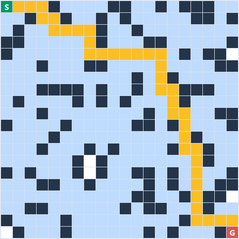
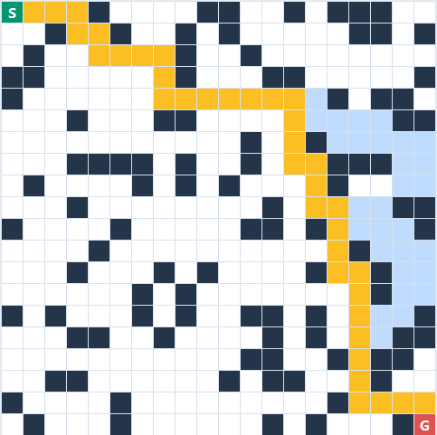

# Visual Maze Solver: A* vs BFS

CSBP301 Artificial Intelligence final project by Abdalla Abdelsamie.

An interactive Python application that finds shortest routes through editable
grid mazes and compares breadth-first search with A* search.

## Run

Python 3.12 or newer and Tkinter are needed. The recorded experiment used Python
3.14.7 on Windows 11. Official Windows Python installers include Tcl/Tk.
No third-party Python packages are required.

From the project folder:

    python main.py

In PyCharm, open this folder, select a Python interpreter, then run main.py.
If Tkinter is missing, repair the Python installation and enable Tcl/Tk and IDLE.
Check it with: python -m tkinter

## Controls

- Choose a preset map, select BFS or A*, and click Run selected.
- Choose Wall, Erase, Start, or Goal, then click or drag on the grid to edit.
- Compare both runs the algorithms on the same current grid without animation.
- Stop stops the animation. The measured search has already completed.
- Reset preset restores the selected map. Clear search removes search overlays.
- Export 10-map benchmark writes measurements for the fixed presets to a folder.
  Custom edits are not part of that benchmark.

Dark cells are walls, blue cells were expanded, and yellow cells form the path.
Green S is the start and red G is the goal. Movement is four-directional with
unit cost. Path length counts moves, not the number of cells in the route.

## Example: random map with seed 21

| BFS | A* |
| --- | --- |
|  |  |
| 293 expanded cells | 68 expanded cells |

Both algorithms return 38 path steps on this map. A* expands 76.8% fewer cells.
The comparison screenshot is a single GUI run. The table below reports medians
from the separate repeated benchmark; its timings need not match that screenshot.

## Recorded benchmark

The experiment uses ten fixed maps, including three seeded random maps and two
intentionally unreachable goals. Each algorithm has three warmup runs and 50
measured runs per map. Algorithm order alternates. Timing includes validation,
search, and path reconstruction, and excludes drawing and animation.

| Map | Grid | Path steps | BFS expansions | A* expansions | BFS median ms | A* median ms |
| --- | --- | ---: | ---: | ---: | ---: | ---: |
| 01 Open field | 10x10 | 18 | 100 | 19 | 0.0848 | 0.0340 |
| 02 Wall detour | 10x10 | 23 | 87 | 49 | 0.0720 | 0.0741 |
| 03 Zigzag | 15x15 | 72 | 165 | 149 | 0.1372 | 0.2133 |
| 04 Three rooms | 20x20 | 34 | 283 | 35 | 0.2463 | 0.0784 |
| 05 Narrow corridor | 15x15 | 28 | 29 | 29 | 0.0298 | 0.0416 |
| 06 Random seed 7 | 20x20 | 38 | 328 | 50 | 0.2739 | 0.0991 |
| 07 Random seed 21 | 20x20 | 38 | 293 | 68 | 0.2410 | 0.1167 |
| 08 Random seed 42 | 30x30 | 60 | 606 | 207 | 0.5207 | 0.3650 |
| 09 Blocked goal | 10x10 | No route | 97 | 97 | 0.0808 | 0.1720 |
| 10 Disconnected | 20x20 | No route | 200 | 200 | 0.1766 | 0.3913 |

Both methods find routes on eight maps and report no route on the other two.
They agree on all eight reachable path lengths. A* uses 903 total expansions,
compared with 2,188 for BFS, a 58.7% reduction across this particular map set.
A* expands fewer cells on seven maps and is faster on five maps. On the zigzag,
corridor, and unreachable maps, heap operations and heuristic evaluation can
add overhead with limited or no reduction in search effort.

These are small, synthetic maps on one computer. No claim of universal speed
improvement or statistical significance is made. Raw CSV values retain more
precision than the rounded display above. Processor and timing details are in
results/environment.json. Expansion counts are counts of processed cells,
including the start and the goal when reached.

## Reproduce the experiment

    python benchmark.py

This writes new measurements to results/benchmark.csv and results/environment.json.
To preserve the supplied measurements, choose another output folder:

    python benchmark.py --output new_results --repeats 50

The benchmark exports medians, minima, and maxima; individual run samples are
not retained. Hardware load and Python version can change timings.

## Correctness checks

    python -m unittest -v

The suite checks known shortest paths, unreachable goals, identical start and
goal, invalid grids, all 128 wall arrangements on a 3x3 grid with fixed open
endpoints, valid adjacent route steps, deterministic presets, unchanged input
data, agreement between algorithms, and export of all 20 map/algorithm rows.

## Algorithms

BFS uses a FIFO queue, implemented with collections.deque. A* uses heapq with
priority f = g + h, where g counts steps taken and h is Manhattan distance.
For equal f, the implementation prefers larger g, then coordinates. With
four-direction movement and unit costs, Manhattan distance is admissible and
consistent. Both algorithms can therefore return shortest routes under these
rules. A* uses a closed set, and the consistency condition matters because
closed cells are not reopened. Changing to diagonal or weighted movement needs
an appropriate heuristic and a new comparison method.

## Files

- main.py: Tkinter interface, editing, visualization, and animation.
- search.py: BFS, A*, input checks, and parent-pointer reconstruction.
- mazes.py: ten fixed map definitions and seeded generation.
- benchmark.py: timed experiments and CSV/metadata export.
- test_search.py: correctness checks.
- results/: the recorded benchmark and environment details.
- images/: supplied application screenshots.

## Sources and assistance

- UC Berkeley CS188, Uninformed Search:
  https://inst.eecs.berkeley.edu/~cs188/textbook/search/uninformed.html
- UC Berkeley CS188, Informed Search:
  https://inst.eecs.berkeley.edu/~cs188/textbook/search/informed.html
- Python Tkinter documentation:
  https://docs.python.org/3.14/library/tkinter.html

ChatGPT assisted with code generation, debugging guidance, analysis, and writing.
The supplied implementation was checked against automated tests and actual
benchmark output. The project does not copy the Berkeley assignment source.
